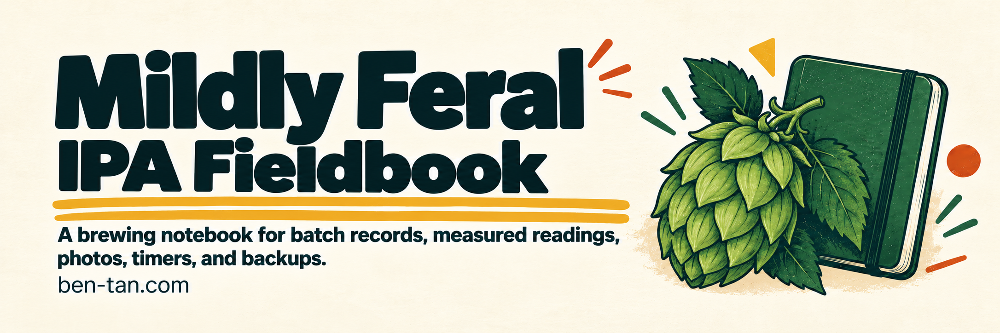

# Mildly Feral — IPA & kombucha

A personal brewing fieldbook for IPA and kombucha: recipes, batch notes, readings, photos, and tasting notes.

<p>
<a href="#run-locally"></a>&nbsp;
</p>

[](docs/images/banner.png)

## What it does

- **IPA:** work through preparation, steeping, boiling, chilling, fermentation, bottling, and tasting, with checklists and confirmed recipe instructions.
- **Kombucha:** brew separate batches through tea preparation, starter culture, fermentation, flavoring, bottling, and tasting, with starter notes, measured pH and temperature, and bottle flavor groups.
- Keep the Kombucha Shop recipe reference separate from the longer house fermentation method.
- Save batch notes, dates, readings, tasting entries, and photographs.
- Estimate IPA alcohol content from measured original and final gravity, and use a recoverable brew timer.
- Export saved records and photos, recover deleted items, and import backups without silently replacing existing records.

[Open Mildly Feral](https://mildly-feral.tanjamin-ben.chatgpt.site). Sign in to keep your own brewing notebook. You can also launch it from Play on [ben-tan.com](https://ben-tan.com).

## Run locally

This source snapshot omits runtime artwork and hosted project identity. Supply the appropriately licensed files listed in [ASSET-REQUIREMENTS.json](ASSET-REQUIREMENTS.json) before running the interface. [Source snapshot scope](SOURCE-SNAPSHOT.md).

Use Node.js 22.13 or newer. Install the locked dependencies and build the local Worker configuration:

```sh
npm run install:ci
npm run build
node --import ./scripts/sites-env.mjs ./node_modules/wrangler/bin/wrangler.js d1 execute DB --local --config dist/server/wrangler.json --persist-to .wrangler/state --file drizzle/0000_purple_speed_demon.sql
npm run dev -- --hostname 127.0.0.1
```

The database command initializes a fresh **local** notebook; do not replay it against an existing database. Open the URL printed by the server, then visit `/signin-with-chatgpt?return_to=/` for the loopback development identity. Hosted sign-in is a separate service and is not simulated in production builds.

## Build and check

```sh
node node_modules/typescript/bin/tsc --noEmit
node scripts/check-improvements.mjs
node scripts/check-abv.mjs
node scripts/check-backup.mjs
node scripts/check-review-brewing.mjs
node scripts/check-kombucha.mjs
npm run build
```

The built Worker can be previewed locally with `npm start`. Hosting requires configured authentication, D1, and R2 bindings. A Git push or local build does not deploy the app.

## Limitations

Saved notebooks use D1 and photos use R2 under the signed-in user's identity. Drafts and timers remain in browser storage and do not synchronize across devices. A connection is needed to save. Backups contain private notebook data, including saved photos and Trash; store them accordingly. Limits are 40 batches, 500 entries, and 60 photos per owner.

The IPA alcohol calculator estimates ABV from temperature-corrected gravity readings. These calculations do not apply to kombucha. Kombucha has its own pH, temperature, and taste records; the notebook does not infer bottle pressure or readiness. It does not determine fermentation completion or a safe priming-sugar dose. Recipe targets never substitute for measured readings. The timer does not promise notifications after the page is closed.

Notebook schema 2 retains existing IPA records and imports schema-1 backups additively. New backups include both kinds of brewing, including flavor groups, photos, and Trash. Storage limits are shared across both editions. See [Kombucha workflow and compatibility](docs/KOMBUCHA.md).

## License and credits

No blanket open-source license is granted. The Hop icon is from Lucide under the ISC license; retain its SVG notice and other applicable dependency licenses. Included Barlow and Barlow Semi Condensed fonts are licensed under the SIL Open Font License; their notices are in `public/fonts/`. Brewing references inform the notebook and do not replace a recipe's verified instructions or the brewer's judgment.

---

Made by [Ben Tan](https://ben-tan.com). [Report a security issue](SECURITY.md).
